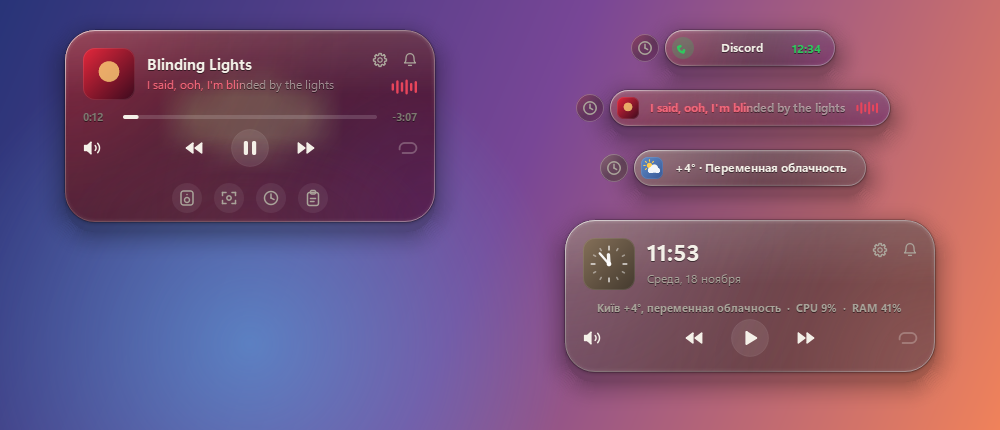

# Default Island

**Dynamic Island для Windows**: чёрная капсула вверху экрана, которая показывает музыку, звонки, уведомления и многое другое и раскрывается в плеер при наведении мыши.



**[⬇ Скачать установщик](https://github.com/lourchik69/default-island/releases/latest)** · Windows 10 / 11, 64-бит · бесплатно и с открытым кодом (MIT)

## Что умеет

**Музыка**
- Трек, обложка, визуализатор под настоящий звук, плеер с перемоткой, громкостью и повтором
- Spotify, Яндекс Музыка, Apple Music, браузеры — всё, что показывает Windows, а с расширением для браузера ещё точнее: SoundCloud, YouTube Music, VK и другие сайты
- Обычные видео с YouTube в островок не попадают — это включается в настройках («Музыка → Видео с YouTube»)
- Синхронный текст песни с подсветкой слов как в караоке, перевод строк
- Лайк и добавление в плейлист (SoundCloud)
- Ползунок громкости для любой программы или для всей системы

**Звонки**
- Входящий звонок (Связь с телефоном, WhatsApp, Viber…) — карточка с кнопками «Принять» и «Отклонить»
- Идущий звонок в Discord, Telegram, Teams, Zoom… — зелёная трубка и таймер прямо в островке

**Всё остальное**
- Когда музыка не играет: часы и дата, погода, загрузка компьютера или пустая капсула
- Уведомления Windows, заряд ноутбука и Bluetooth-наушников, загрузки в браузере
- Точки приватности как на iPhone: оранжевая — микрофон, зелёная — камера, красная — запись экрана
- Громкость и яркость, буфер обмена с историей, раскладка клавиатуры
- Таймер и секундомер, напоминания, быстрые кнопки, полка для файлов
- Режим «Только музыка», темы Liquid Glass, русский, украинский и английский

## Установка

1. Скачайте `DefaultIsland-Setup.exe` со страницы [Releases](https://github.com/lourchik69/default-island/releases/latest) и запустите.
2. Выберите папку и настройки: ярлык, запуск вместе с Windows, автоматические обновления.

Права администратора не нужны. Удалить можно в «Параметры → Приложения». Windows SmartScreen может предупредить о неизвестном издателе: нажмите «Подробнее → Выполнить в любом случае» (у программы нет платной цифровой подписи).

### Расширение для браузера (необязательно)

Без него островок видит музыку через Windows. С ним — точнее на сайтах, плюс лайки, плейлисты и загрузки.

1. Откройте `brave://extensions` или `chrome://extensions` (или `edge://extensions`).
2. Включите «Режим разработчика».
3. Нажмите «Загрузить распакованное» и выберите папку `browser-extension` в папке программы (в меню «Пуск» есть ярлык «Расширение для браузера»).

## Какие данные уходят в интернет

Только то, что нужно включённой функции:

| Функция | Что отправляется | Куда |
| --- | --- | --- |
| Текст песен | название трека и исполнитель | lrclib.net, music.163.com |
| Перевод текста | строки песни | Google Переводчик |
| Погода | название города, потом координаты | open-meteo.com |
| Обновления | только запрос о новой версии | github.com |

Уведомления, звонки, буфер обмена и всё остальное обрабатываются на компьютере и никуда не отправляются.

## Сборка из исходников

```
pip install -r requirements.txt
winget install JRSoftware.InnoSetup
python build.py
```

Готовый установщик появится в `dist/DefaultIsland-Setup.exe`. Запустить без сборки: `python island.py`.

## Лицензия

[MIT](LICENSE): можно использовать, изменять и распространять свободно.

---

*English:* Default Island brings an iPhone-style Dynamic Island to Windows 10/11: now playing with synced karaoke lyrics, calls, notifications, privacy dots, weather and more. Download the installer from [Releases](https://github.com/lourchik69/default-island/releases/latest). MIT licensed.
